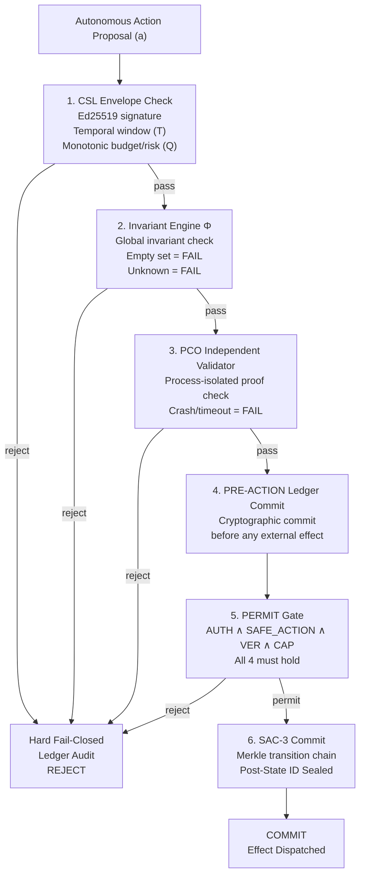

# LLM-SEC: Safe Super Intelligence (SSI) Execution Gateway

> **Version:** `v0.1.0`  
> **Axiomatic Specification:** [`docs/REQUIREMENTS.md`](docs/REQUIREMENTS.md)  
> **Governance & Operational Rules:** [`AGENTS.md`](AGENTS.md)  
> **Honest Conformance Matrix:** [`docs/CONFORMANCE.md`](docs/CONFORMANCE.md)  
> **Certified Conformance Level:** **CONF-2 (Reproducible)** overall; **CONF-3 (Bounded Model Checking)** for core protocol.

High-Assurance Security Architecture, Formally Modeled Gating, and Deterministic Enforcement for Autonomous AI Agent Execution.

---

## 1. Architectural Vision & Problem Statement

Modern AI agents interfacing with external tools, APIs, and databases require deterministic, non-bypassable security barriers. Heuristic "LLM-as-a-judge" filters and prompt guardrails fail under adversarial manipulation, floating-point non-determinism, and prompt injection.

`LLM-SEC` is an execution gateway standing between untrusted model proposals and external sinks. Built upon the **Safe Super Intelligence (SSI) Axiomatic System v1.0**, it enforces:

1. **Zero Floating-Point in Kernel (PURE WAD-18):** 18-decimal fixed-point integer scaling ($10^{18}$) over 256-bit signed arithmetic, certified float-free via a 3-layer compilation/linter barrier.
2. **Deterministic 5-Stage Gating:** $\text{VERIFY} \to \text{TRANSITION} \to \text{INVARIANT\_CHECK} \to \text{COMMIT}$. Side effects are strictly forbidden prior to atomic ledger commit.
3. **Tri-State Fail-Closed Invariant Engine:** Explicit invariant set $\Phi = \{\varphi_1, \dots, \varphi_n\}$. $\Phi = \emptyset \implies \text{FAIL}$; $\text{Unknown} \implies \text{FAIL}$.
4. **Independent Proof-Carrying Output (PCO):** External, process-isolated proof validation with pre-action cryptographic commitment before external execution (Avni et al., IACR 2026/994).
5. **Governed Model Evolution ($R^3$ / $\text{ADOPT}$):** Partitions the system into $(K, M, G)$. Requires byte-for-byte kernel equality and comprehensive non-regression testing before config adoption.
6. **Commercial Real-Estate Underwriting Pack:** Production domain pack enforcing statutory LTV caps, DSCR floors, and Ed25519 dual-human authorization.

---

## 2. Gating Pipeline Order



---

## 3. Workspace Layout

```text
LLM-SEC/
├── crates/                            # High-Assurance Rust Crates (zero unsafe)
│   ├── wad18/                         # Fixed-point 10^-18 integer arithmetic (#![no_std])
│   ├── ssi-kernel/                    # State tuple X=(I,S,A,H,V,P), invariant engine Φ
│   ├── ssi-gate/                      # 5-stage pipeline, evaluate_permit(), GateDecision
│   ├── ssi-csl/                       # Cognitive State Ledger: Ed25519 signed envelopes
│   ├── ssi-ledger/                    # RFC 8785 canonical encoding ENC(X), Merkle chain
│   ├── ssi-pco/                       # Proof-Carrying Output independent validator & pre-action seal
│   └── ssi-r3/                        # Governed evolution (K,M,G) and ADOPT(Y) non-regression
├── packs/
│   └── real-estate/                   # Commercial underwriting execution gateway
├── specs/
│   └── tla/                           # Formal TLA+ specifications & TLC configs
├── tools/
│   ├── pure_wad18/                    # 3-Layer float-freedom compiler scanner
│   ├── mutation_engine/               # 15 canonical adversarial mutation engine
│   └── trace-validator/               # Runtime TLA+ trace conformance checker
├── core/                              # Preserved Python prototype (differential oracle)
├── docs/
│   ├── REQUIREMENTS.md                # Normative Specification (SSOT)
│   └── CONFORMANCE.md                 # Complete, honest conformance evidence register
├── reports/                           # Machine-readable verification verdict & audits
├── Dockerfile                         # Pinned hermetic reproducibility capsule
└── Makefile                           # Unified automation: make verify
```

---

## 4. Honest Conformance Register (PO-1 through PO-9)

In accordance with [`AGENTS.md`](AGENTS.md) Rule 3, `LLM-SEC` reports honest conformance ratings with links to machine-checked verification artifacts:

| PO | Obligation Name | Conformance Level | Primary Verification Artifact |
| :---: | :--- | :---: | :--- |
| **PO-1** | **Type Safety & Inhabitance** | **CONF-1** *(Executable)* | Compile-time Rust type system + [`crates/ssi-kernel/tests/kernel_tests.rs`](crates/ssi-kernel/tests/kernel_tests.rs) |
| **PO-2** | **WAD-18 Arithmetic Soundness** | **CONF-2** *(Reproducible)* | PURE WAD18 3-Layer Certification ([`reports/pure_wad18_report.md`](reports/pure_wad18_report.md)) + [`crates/wad18/tests/proptests.rs`](crates/wad18/tests/proptests.rs) |
| **PO-3** | **Authorization Soundness** | **CONF-3** *(Bounded Model Checking)* | TLC Model Checker ([`specs/tla/SSI_Kernel.tla`](specs/tla/SSI_Kernel.tla), 172,020 states, depth 10) |
| **PO-4** | **Verification Soundness** | **CONF-3** *(Bounded Model Checking)* | TLC Model Checker (`SSI_Kernel.tla`) + [`crates/ssi-pco/src/validator.rs`](crates/ssi-pco/src/validator.rs) |
| **PO-5** | **Invariant Preservation** | **CONF-3** *(Bounded Model Checking)* | TLC Inductive Check + [`tools/trace-validator`](tools/trace-validator) (1,000 steps verified) |
| **PO-6** | **Cryptographic Lineage Binding** | **CONF-1** *(Executable)* | RFC 8785 Canonical JSON + [`crates/ssi-ledger/tests/ledger_tests.rs`](crates/ssi-ledger/tests/ledger_tests.rs) |
| **PO-7** | **Safety Kernel Immutability** | **CONF-1** *(Executable)* | `KernelManifest` byte comparison + MUT-15 check ([`crates/ssi-r3/tests/r3_tests.rs`](crates/ssi-r3/tests/r3_tests.rs)) |
| **PO-8** | **Recursive Non-Regression** | **CONF-1** *(Executable)* | Invariant suite $\Phi$ + 15 mutation checks on candidate ([`crates/ssi-r3/src/non_regression.rs`](crates/ssi-r3/src/non_regression.rs)) |
| **PO-9** | **Deterministic Reproducibility** | **CONF-2** *(Reproducible)* | Hermetic `Dockerfile` + `make verify` + [`crates/ssi-ledger/src/bin/replay_audit.rs`](crates/ssi-ledger/src/bin/replay_audit.rs) |

> [!NOTE]
> Conformance levels are assigned strictly per evidence: **CONF-1** for executable test suites, **CONF-2** for reproducible builds, and **CONF-3** for bounded model checking. No component claims CONF-4 (unbounded pencil-and-paper inductive proof). See [`docs/CONFORMANCE.md`](docs/CONFORMANCE.md).

---

## 5. Adversarial Security: 15 Canonical Mutations

The kernel is continuously tested against an automated 15-mutant adversarial suite (`tools/mutation_engine`). Every mutant is caught and rejected fail-closed (**15/15 caught, 100% detection rate**):

- Unknown verification rejected as unsafe (`MUT-01`, `MUT-04`)
- Empty invariant set rejected (`MUT-02`)
- CSL revocation & expiration enforced (`MUT-03`, `MUT-08`)
- Pre-commit invariant check ordering enforced (`MUT-05`)
- Inexact arithmetic, silent truncation, and sign loss caught (`MUT-07`, `MUT-11`, `MUT-12`, `MUT-13`, `MUT-14`)
- State-binding and capability escalation blocked (`MUT-09`, `MUT-10`)
- R3 adoption without byte-exact kernel equality rejected (`MUT-15`)

Full report: [`reports/mutation_report.md`](reports/mutation_report.md).

---

## 6. One-Command Reproducibility (`PO-9`)

Execute the complete formal verification pipeline across all 8 stages:

```bash
# Run unified verification pipeline
make verify
```

This sequentially executes:
1. Workspace compilation
2. PURE WAD18 3-layer float-freedom scan + 3 negative controls
3. Rust workspace test suite
4. TLC model checker on `SSI_Kernel.tla` (depth 10)
5. 15-mutant adversarial engine
6. Cryptographic offline replay audit
7. Real-estate underwriting acceptance run (demo + 6 red-team attacks)
8. SBOM generation

Emits machine-readable verdict JSON at [`reports/verification_verdict.json`](reports/verification_verdict.json).

### Reproducible Docker Capsule

```bash
# Build reproducible hermetic container
docker build -t llmsec-gateway:0.1.0 .

# Execute verification inside isolated container
docker run --rm llmsec-gateway:0.1.0 make verify
```

---

## 7. Known Limitations & Out-of-Scope Preconditions

1. **Host Kernel Integrity:** Out-of-process validator isolation relies on the OS process boundary. Host OS root compromise is out of scope.
2. **Model Checking Depth:** TLA+ verification was conducted via bounded model checking (TLC to depth 10, 172,020 states explored). Inductive unbounded mathematical proof is out of scope for v0.1.0.
3. **Input Data Truthfulness:** The gateway verifies that presented inputs satisfy all formal safety constraints; verifying the external real-world truth of appraisal data is out of scope.
