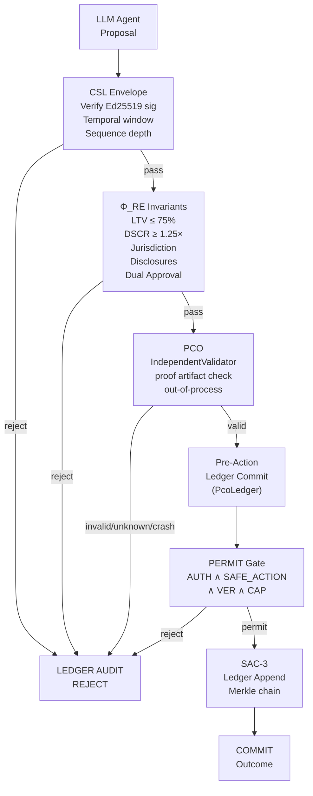

# Architecture — SSI Real-Estate Underwriting Pack

## Pipeline Diagram



## Module Map

```
packs/real-estate/
├── src/
│   ├── lib.rs              — public re-exports
│   ├── error.rs            — RealEstateError (13 variants)
│   ├── types.rs            — LoanApplication, DualHumanApproval, WAD-18 constants
│   ├── invariants.rs       — verify_real_estate_invariants() → Φ_RE enforcement
│   ├── csl_preset.rs       — UnderwritingTier enum + CSL signing CLI
│   ├── sac_mapping.rs      — RealEstateInvariantCategory → SAC class mapping
│   └── pipeline.rs         — RealEstateUnderwritingGateway (CSL→PERMIT→PCO→Ledger)
│   bin/
│   ├── csl_signer.rs       — Key generation + CSL signing CLI
│   ├── re_demo.rs          — 2-scenario end-to-end demo
│   └── re_redteam.rs       — 6-attack adversarial test suite
└── tests/
    └── re_tests.rs         — 10 integration tests
```

## Key Types

| Type | Crate | Purpose |
|------|-------|---------|
| `LoanApplication` | `ssi-real-estate` | Borrower application with WAD-18 financial fields |
| `DualHumanApproval` | `ssi-real-estate` | Ed25519 dual-signatory struct; required for loans ≥ \$1M |
| `CSLEnvelope` | `ssi-csl` | Signed authorization envelope (E, T, Q triple) |
| `VerificationCertificate` | `ssi-pco` | PCO certificate with state binding (BOUND check) |
| `PcoLedger` | `ssi-pco` | Pre-action immutable commitment ledger |
| `AppendOnlyLedgerStore` | `ssi-ledger` | SAC-3 Merkle transition ledger |
| `SystemState` | `ssi-kernel` | Full 6-tuple system state X = (I, S, A, H, V, P) |

## Φ_RE Invariant Set

| ID | Invariant | WAD-18 Constant | PO |
|----|-----------|-----------------|-----|
| RE-1 | LTV ≤ 75% | `LTV_CAP_WAD = 750_000_000_000_000_000` | PO-2, PO-5 |
| RE-2 | DSCR ≥ 1.25× | `DSCR_FLOOR_WAD = 1_250_000_000_000_000_000` | PO-2, PO-5 |
| RE-3 | Loan ≤ single-loan cap | `SINGLE_LOAN_CAP_WAD` (Tier-dependent) | PO-2 |
| RE-4 | Jurisdiction whitelisted | {US-NY, US-CA, US-TX, US-FL, US-IL} | PO-3 |
| RE-5 | Mandatory disclosures present | Phase-1 env, flood cert, rent roll, AML/KYC | PO-4 |
| RE-6 | Dual human approval for high-value | ≥\$1M loan or LTV ≥ 70% requires 2 Ed25519 sigs | PO-3 |

## SAC Evidence Levels

| Invariant Category | SAC Class | Description |
|-------------------|-----------|-------------|
| WAD-18 arithmetic bounds | SAC-2 Algorithmic | Formally specified arithmetic invariants |
| Jurisdiction / eligibility | SAC-1 Policy | Rule-based domain constraints |
| Mandatory disclosures | SAC-1 Policy | Checklist enforcement |
| Dual-human authorization | SAC-3 Formal Provenance | Cryptographic multi-party signature |
| CSL temporal validity | SAC-3 Formal Provenance | Signed envelope with hard expiry |
| PCO proof validity | SAC-3 Formal Provenance | Out-of-process independent verification |
